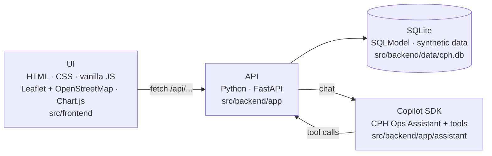

# CPH Agentic Hack with GitHub Copilot

Starter boilerplate for **CPH Agentic Hack with GitHub Copilot**: build an intelligent Copenhagen
Airport operations app with Python, SQLite, OpenStreetMap and the Copilot SDK, using custom
instructions, agents, skills and MCP. The app runs on first clone; the track features are
yours to build.



## Prerequisites

- **One of these two tools** (team members can mix them):
  - [VS Code](https://code.visualstudio.com/) with the GitHub Copilot Chat extension, **or**
  - the [GitHub Copilot app](https://github.com/features/ai/github-app) (desktop). See
    **[docs/copilot-app.md](docs/copilot-app.md)** for how the workshop steps map to the app.
- A **GitHub Copilot licence** and a GitHub account **signed in** to VS Code or the app
- **Python 3.11+** and **Git**
- Internet access to PyPI, unpkg.com (Leaflet, Chart.js) and tile.openstreetmap.org

## Get the code: fork or clone

Pick **one path per team**. Full step-by-step instructions are in **[docs/getting-started.md](docs/getting-started.md)**.

| | Path A · Fork (recommended) | Path B · Clone |
|---|---|---|
| When | You want your own copy on GitHub (no write access to this repo needed) | The organisers gave your team write access, or you only work locally |
| Command | `gh repo fork hosseinzahed/cph-agentic-hack --clone` | `git clone https://github.com/hosseinzahed/cph-agentic-hack.git` |
| Then | Enable Issues on your fork and run `gh repo set-default <you>/cph-agentic-hack` | Use branches named `<team>/<track>`; never push to `main` |
| Issues, branches, PRs | In your fork (PR base = **your fork**) | In this repo, prefixed with your team name |

Using the **GitHub Copilot app**? Connect the fork or clone with **+ → Open local folder** or
**Add GitHub repository**, then run the setup below. See [docs/copilot-app.md](docs/copilot-app.md).

## Setup, run and test

Run everything **from the repository root** (`cd cph-agentic-hack`).

| | Windows (PowerShell) | macOS / Linux (bash) |
|---|---|---|
| Set up (venv, install, Copilot runtime, seed) | `.\src\scripts\setup.ps1` | `./src/scripts/setup.sh` |
| Activate the venv | `.\.venv\Scripts\Activate.ps1` | `source .venv/bin/activate` |
| Readiness check | `python src\scripts\check_env.py` | `python src/scripts/check_env.py` |

Run the app, then open http://localhost:8000 (API docs at http://localhost:8000/docs):

```bash
uvicorn backend.app.main:app --app-dir src --reload
```

Test:

```bash
pytest
```

Reseed the database (deterministic synthetic data for today; also refreshes flight statuses):

```bash
python src/backend/scripts/seed.py
```

## Repo tour

All **code is in `src/`**; the **workshop guide is in `docs/`**.

| Path | What's there |
|---|---|
| `src/backend/app/` | FastAPI app: `main.py`, `db.py`, `models.py`, `routers/` (one per track; `airports.py` is the reference), `assistant/` (Copilot SDK skeleton) |
| `src/backend/data/` | `airports.csv` and the generated `cph.db` (git-ignored) |
| `src/backend/scripts/seed.py` | Creates the database with one synthetic "hack day" |
| `src/backend/tests/` | pytest smoke tests (health, airports, 501 stubs) |
| `src/frontend/` | `index.html`, `theme.css` (all colours), `styles.css`, `app.js` (map + helpers), `tracks/*.js` |
| `src/scripts/` | `setup.ps1`, `setup.sh`, `check_env.py` |
| `docs/` | Workshop guide: getting started (fork or clone), flow, one file per track, assistant step, ideas, UiPath hand-off, diagrams |
| `.github/` | Copilot instructions, custom agents, skills, prompt files, issue template |
| `.vscode/` | MCP servers, recommended extensions, Python/pytest settings |
| `.mcp.json` | The same MCP servers in the native Copilot format (used by the GitHub Copilot app and Copilot CLI) |

## Start here

Read **[docs/README.md](docs/README.md)**, then [docs/getting-started.md](docs/getting-started.md) (fork or clone), [docs/copilot-app.md](docs/copilot-app.md) if you use the GitHub Copilot app, [docs/workshop-flow.md](docs/workshop-flow.md) and your track:

| Track | Guide | You build |
|---|---|---|
| 1 · Passenger onboarding | [docs/track-1-passenger-onboarding.md](docs/track-1-passenger-onboarding.md) | Queue heatmap, wait-time forecast, security wait KPIs |
| 2 · Flight plans | [docs/track-2-flight-plans.md](docs/track-2-flight-plans.md) | World route map, departures/arrivals board, flight search |
| 3 · Disruptions | [docs/track-3-disruptions.md](docs/track-3-disruptions.md) | Disruption circles, affected routes, impact list |
| 4 · Gates & baggage | [docs/track-4-gates-and-baggage.md](docs/track-4-gates-and-baggage.md) | Stand Gantt, conflicts, transfer bags at risk |
| All · Assistant | [docs/assistant-and-finale.md](docs/assistant-and-finale.md) | Copilot SDK tools and the CPH Ops Assistant |

Every gap in the code is marked `HACK(<track>)`: search for it.

## Copilot features in this repo

| Type | File | When to use it |
|---|---|---|
| Repo instructions | [.github/copilot-instructions.md](.github/copilot-instructions.md) | Always on: architecture, commands, rules, CPH glossary |
| Instructions | [.github/instructions/python.instructions.md](.github/instructions/python.instructions.md) | Automatically for `src/backend/**/*.py` |
| Instructions | [.github/instructions/frontend.instructions.md](.github/instructions/frontend.instructions.md) | Automatically for `src/frontend/**`: vanilla JS, Leaflet, Chart.js, theme rules |
| Instructions | [.github/instructions/a11y.instructions.md](.github/instructions/a11y.instructions.md) | Automatically for `src/frontend/**`: WCAG 2.2 AA (from awesome-copilot) |
| Instructions | [.github/instructions/copilot-sdk-python.instructions.md](.github/instructions/copilot-sdk-python.instructions.md) | Automatically for `src/backend/app/assistant/**` (from awesome-copilot) |
| Custom agent | [.github/agents/architect.agent.md](.github/agents/architect.agent.md) | Plan a track: API contract, draw.io diagram, GitHub issues and branch (25–40 min) |
| Custom agent | [.github/agents/map-builder.agent.md](.github/agents/map-builder.agent.md) | Build Leaflet layers: routes, markers, circles, legends |
| Custom agent | [.github/agents/reviewer.agent.md](.github/agents/reviewer.agent.md) | Read-only review before your PR: security, a11y, synthetic data, theme, tests |
| Skill | [.github/skills/seed-data-generator/SKILL.md](.github/skills/seed-data-generator/SKILL.md) | Add deterministic synthetic data to `seed.py` |
| Skill | [.github/skills/leaflet-map/SKILL.md](.github/skills/leaflet-map/SKILL.md) | Map recipes, with [snippets.js](.github/skills/leaflet-map/snippets.js) |
| Skill | [.github/skills/copilot-sdk-tool/SKILL.md](.github/skills/copilot-sdk-tool/SKILL.md) | Expose a backend function as a Copilot SDK tool |
| Prompt file | [.github/prompts/new-endpoint.prompt.md](.github/prompts/new-endpoint.prompt.md) | `/new-endpoint` (VS Code): scaffold an endpoint, model and tests like `airports.py`. App: "Follow `.github/prompts/new-endpoint.prompt.md` for …" |
| Prompt file | [.github/prompts/write-tests.prompt.md](.github/prompts/write-tests.prompt.md) | `/write-tests` (VS Code): pytest tests for the selected router. App: "Follow `.github/prompts/write-tests.prompt.md` for …" |
| Prompt file | [.github/prompts/explain-this-repo.prompt.md](.github/prompts/explain-this-repo.prompt.md) | `/explain-this-repo` (VS Code): 5-minute tour for newcomers. App: "Follow `.github/prompts/explain-this-repo.prompt.md`" |
| MCP server | `github` in [.vscode/mcp.json](.vscode/mcp.json) (VS Code) and [.mcp.json](.mcp.json) (app) | Issues, branches and PRs from chat (`@architect`) |
| MCP server | `microsoft-learn` in [.vscode/mcp.json](.vscode/mcp.json) (VS Code) and [.mcp.json](.mcp.json) (app) | Look up Microsoft docs and best practice |
| MCP server | `drawio` in [.vscode/mcp.json](.vscode/mcp.json) (VS Code) and [.mcp.json](.mcp.json) (app) | Draw flows and sequence diagrams into `docs/diagrams/` |
| Issue template | [.github/ISSUE_TEMPLATE/hack-track.md](.github/ISSUE_TEMPLATE/hack-track.md) | One task per track issue |

> **GitHub Copilot app:** instructions, custom agents, skills and MCP servers work in the app as
> they are. Prompt files and the `@architect` handoff button are VS Code features; the app
> equivalents are in [docs/copilot-app.md](docs/copilot-app.md#4-copilot-features-vs-code-vs-the-app).

> **MCP policy:** your GitHub organisation may need to allow MCP servers (including the
> third-party draw.io server) in its Copilot policies. VS Code asks you to start and trust each
> server the first time; sign in to GitHub when the `github` server asks. In the app, check
> **Customize → MCP → Installed**.

## Troubleshooting

| Problem | Fix |
|---|---|
| **Proxy / pip install fails** | Set `HTTPS_PROXY`, or `pip config set global.index-url <your mirror>`, then rerun setup. |
| **`python3 -m venv` fails on Ubuntu/Debian** | Install the venv module: `sudo apt install python3-venv`, then rerun `./src/scripts/setup.sh` (it recreates a broken `.venv` automatically). |
| **"Running scripts is disabled on this system" (Windows)** | Allow local scripts for your user: `Set-ExecutionPolicy -Scope CurrentUser RemoteSigned`, or run `powershell -ExecutionPolicy Bypass -File .\src\scripts\setup.ps1`. |
| **Wrong Python version in `.venv`** | Install Python 3.11+ and rerun setup; it replaces a `.venv` that is older than 3.11. On macOS you can pick one explicitly: `PYTHON=python3.12 ./src/scripts/setup.sh`. |
| **CDN blocked (no map or charts)** | Vendor the libraries: download `leaflet.js`, `leaflet.css` (+ its `images/` folder) from `https://unpkg.com/leaflet@1.9.4/dist/` and `chart.umd.js` from `https://unpkg.com/chart.js@4.6.1/dist/` into `src/frontend/vendor/`, then point the `<link>`/`<script>` tags in `index.html` at `vendor/...` (drop the `integrity` attributes or keep them, the hashes match). Map tiles still need tile.openstreetmap.org. |
| **Copilot SDK runtime download fails** | Setup continues with a warning. Retry with `python -m copilot download-runtime`; behind a proxy set `HTTPS_PROXY`. The app works without it until the assistant step. |
| **`CERTIFICATE_VERIFY_FAILED` on macOS** | Python from python.org ships without root certificates: run `/Applications/Python 3.x/Install Certificates.command` (or use Homebrew Python), then rerun setup. |
| **SDK check: not signed in / no licence** | Sign in to GitHub in VS Code, the GitHub Copilot app or the Copilot CLI (or set `GH_TOKEN`) and confirm your Copilot licence. The check is optional. |
| **GitHub Copilot app: "No module named uvicorn" or empty data in a session** | The session runs in a **new worktree** without the git-ignored `.venv` and `cph.db`: run the setup script there, or start sessions with **Current checkout**. See [docs/copilot-app.md](docs/copilot-app.md#2-start-a-session-pick-the-workspace). |
| **GitHub Copilot app: `/new-endpoint` not found** | Prompt files are a VS Code feature. In the app, say "Follow `.github/prompts/new-endpoint.prompt.md` for …". |
| **MCP servers don't start or show "blocked by policy"** | Ask an org admin to allow MCP servers (and the draw.io server) in Copilot policies; start them from the MCP view or `.vscode/mcp.json`. |
| **Issues or PRs land in the wrong repo (fork users)** | Run `gh repo set-default <you>/cph-agentic-hack` and choose your fork as the PR base repository. See [docs/getting-started.md](docs/getting-started.md#troubleshooting). |
| **`git push` fails with 403 after cloning** | You don't have write access: fork instead, or publish your clone as your own repo ([Path B2](docs/getting-started.md#b2-clone-without-write-access-local-only)). |
| **Port 8000 in use** | Stop the other process, or run `uvicorn ... --port 8001` and open that port. |
| **`.drawio` files open as XML** | In VS Code, install the **Draw.io Integration** extension (`hediet.vscode-drawio`, recommended by the workspace). Otherwise open them at https://app.diagrams.net. |
| **`ModuleNotFoundError: backend`** | Run commands from the repository root and keep `--app-dir src`. |
| **Flight statuses look stale** | Statuses are set when the seed runs: `python src/backend/scripts/seed.py`. |

## Data and attribution

- **All data is synthetic.** Flights, passenger flows, disruptions, stand allocations and bag
  tags (`SYN…`) are generated by `src/backend/scripts/seed.py`. There is no real passenger or
  personal data in this repository; never add any (GDPR).
- Airport names and coordinates in `src/backend/data/airports.csv` come from
  [OurAirports](https://ourairports.com/data/) (public domain).
- Map tiles and data © [OpenStreetMap contributors](https://www.openstreetmap.org/copyright).
  The public OSM tile servers are fine for a workshop, not for production traffic
  ([tile usage policy](https://operations.osmfoundation.org/policies/tiles/)).
- The UI is a workshop prototype inspired by the Copenhagen Airport visual identity
  ([design guide](https://www.cph.dk/en/about-cph/press/designguide)). It is not an official CPH
  product and contains no CPH logos, fonts or site assets. Colour values in `theme.css` are
  approximate placeholders.
- Two instruction files are copied from [github/awesome-copilot](https://github.com/github/awesome-copilot) (MIT).
